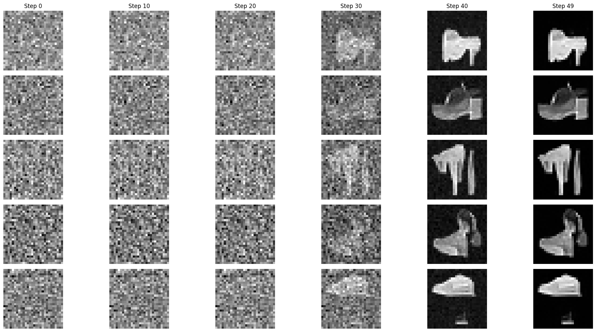

# FashionMNIST EDM Diffusion

<p align="center">
  
</p>

<p align="center">
  <strong>A from-scratch diffusion model for generating FashionMNIST images.</strong>
</p>

This project implements an image-generation pipeline inspired by the
[Elucidating the Design Space of Diffusion-Based Generative Models](https://arxiv.org/abs/2206.00364)
paper by Karras et al. Images are progressively corrupted with Gaussian noise,
then generated by numerically integrating a denoising process from pure noise.

## Highlights

- End-to-end training and sampling pipeline in PyTorch
- EDM-style preconditioning with `c_in`, `c_out`, `c_skip`, and `c_noise`
- Log-normal noise-level sampling during training
- Noise-conditioned residual convolutional network
- Karras-style sigma schedule for sampling
- Euler integration for iterative denoising
- Mixed-precision training on CUDA, with CPU fallback
- Deterministic dataset splitting and random seeds
- Best-validation checkpoint saving
- Sample visualization and approximate FID evaluation

## Project Structure

```text
projet/
├── project.ipynb       # Main experiment: model, training, sampling, evaluation
├── assets/
│   └── sample-grid.png # Figure exported from the notebook
├── other_experiments/  # Earlier exploratory notebooks and helper code
└── README.md
```

## Method

Let $y$ be a clean image and let $\epsilon \sim \mathcal{N}(0, I)$.
During training, a noise level $\sigma$ is sampled from a clipped log-normal
distribution and the model receives:

$$
x = y + \sigma \epsilon.
$$

The denoiser is parameterized using the EDM preconditioning coefficients:

$$
D_\theta(x,\sigma) = c_{\mathrm{skip}}(\sigma)x + c_{\mathrm{out}}(\sigma) F_\theta\left(c_{\mathrm{in}}(\sigma)x, c_{\mathrm{noise}}(\sigma)\right).
$$

The current implementation uses:

- FashionMNIST padded to $32 \times 32$ pixels
- Pixel values normalized to approximately $[-1, 1]$
- 128 convolutional channels
- 8 residual blocks
- 64 noise-conditioning channels
- Mean-squared denoising loss
- Adam optimization
- 50 training epochs by default

At sampling time, the model starts from Gaussian noise at
$\sigma_{\max} = 80$ and follows a 50-step Karras sigma schedule down to
the lowest noise level using Euler updates.

## Requirements

The notebook expects Python 3.10+ and the following packages:

```bash
pip install torch torchvision numpy scipy matplotlib tqdm jupyter
```

For GPU training, install the PyTorch build appropriate for your CUDA version
from the [official PyTorch installation selector](https://pytorch.org/get-started/locally/).

## Possible Improvements

- Replace BatchNorm with GroupNorm for noise-level-independent normalization.
- Use a multi-resolution U-Net architecture for a larger receptive field.
- Test AdamW and lower learning rates such as $10^{-3}$ or $5 \times 10^{-4}$.
- Add Heun sampling and compare it with Euler sampling.
- Use a fixed validation corruption set.
- Evaluate with a FashionMNIST-specific feature space.
- Add class conditioning for controlled clothing-category generation.

## References

- Karras et al., [Elucidating the Design Space of Diffusion-Based Generative Models](https://arxiv.org/abs/2206.00364)
- Ho et al., [Denoising Diffusion Probabilistic Models](https://arxiv.org/abs/2006.11239)
- [Fashion-MNIST dataset](https://github.com/zalandoresearch/fashion-mnist)
